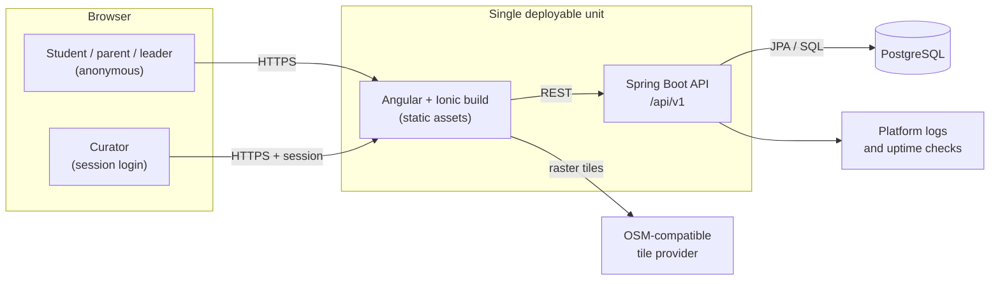

# Architecture

> Status: pre-implementation · Last reviewed 2026-11-14 · Related:
> [LOW_TECH_PILOT.md](LOW_TECH_PILOT.md) · [PAGES.md](PAGES.md) ·
> [SCHEMA.md](SCHEMA.md) · [API.md](API.md) · [DEPLOYMENT.md](DEPLOYMENT.md)

## 1. Purpose and scope

Still Known is a read-mostly web application: anonymous visitors browse and filter a curated set of
churches and campus ministries, while a small number of trusted curators maintain the data through
a protected admin area.

The architecture is optimised for four things, in order:

1. **Trustworthy data** — verification dates, named curators and visible staleness rules matter
   more than any UI feature.
2. **Low operational cost** — one deployable unit, one database, no queue, no search cluster, no
   student accounts.
3. **Fast, forgiving browsing** — a city page should be usable on a mid-range phone on a train.
4. **Easy correction** — a wrong detail should be fixable in minutes, not in a release.

This document describes the system we intend to build. It deliberately excludes product copy and
screen-level detail; those live in [PAGES.md](PAGES.md) and [CURATION.md](CURATION.md).

### 1.1 System boundary

The full solution is layered, and **this repository implements only the map**:

| Layer                                                  | Where it lives                                  | Built here?                    |
|--------------------------------------------------------|-------------------------------------------------|--------------------------------|
| Send-off ritual, connection card, parent briefing      | [LOW_TECH_PILOT.md](LOW_TECH_PILOT.md)          | No — run by the sending church |
| Student, connector and match records                   | A restricted spreadsheet, never this repository | No                             |
| Matchmaker workflow, introduction and follow-up emails | Email/WhatsApp, by hand                         | No                             |
| Church and campus-ministry discovery                   | This application                                | Yes                            |

Consequences for the architecture:

- **No student, parent, connector or match data** is stored, processed or logged by this system.
  There is no `student` table, no connector table and no match table in [SCHEMA.md](SCHEMA.md).
- **No matching, introduction or messaging endpoint** exists in [API.md](API.md). The map does not
  know that a student exists.
- The map's only public input is the private, anonymous **report form**.
- The `Places` tab of the pilot spreadsheet is the low-tech source of truth for map data until the
  admin area replaces it; it enters through CSV import (§5.7) or admin CRUD. The `Students` and
  `Connectors` tabs never do.
- If a future tool needs to store people, it is a **separate application with its own threat model**,
  consent basis and safeguarding controls. It does not get bolted onto this schema.

The low-tech pilot is also the reason the map exists in the form it does: the map's job is to give a
student without a personal contact a verified starting point, and to give the matchmaker a shared,
verified city list. Anything that does not serve those two jobs is out of scope.

## 2. System overview



The frontend and API are separate codebases but ship as **one container** in production: Spring Boot
serves the Angular build from its static resource handler and owns `/api/**`. This removes CORS,
removes a second deployment target, and makes deep links (`/uk/london`, `/places/st-marys-london`)
work without reverse-proxy rules.

A split deployment (CDN for the frontend, separate API host) is documented as an alternative in
[DEPLOYMENT.md](DEPLOYMENT.md), but it is not the default.

## 3. Design goals and constraints

| Goal                         | Target                                       | Consequence                                                     |
|------------------------------|----------------------------------------------|-----------------------------------------------------------------|
| Public reads are anonymous   | No student accounts, no public cookies       | Session security is admin-only; privacy surface stays small     |
| City payload is small        | Under ~150 KB gzipped for 20 places          | Client-side filtering is viable; no search infrastructure       |
| First useful paint           | Under 2.5 s on a mid-range phone over 4G     | Lazy-load the admin bundle; keep map JS in the city route chunk |
| Data can be corrected weekly | Admin edit + verify in under five minutes    | Simple CRUD, CSV import, no approval workflow engine            |
| Trust is visible             | Every public place has a verifier and date   | Visibility rules are enforced server-side, not in the UI        |
| Deploy is boring             | One image, one database, Flyway on startup   | No microservices, no message broker, no Redis in v1             |
| Native path stays open       | Responsive web + Capacitor-compatible layout | No hover-only interactions; safe-area insets; 44 px targets     |

**Hard constraints**

- No student authentication, and therefore no per-user data to leak.
- No public user-generated content other than the private report form.
- No scraping at request time. All place data enters through the admin API or CSV import.
- No structured service times in v1. Church schedules change too often; link out instead.
- Local development must not depend on a paid map key; production uses a tile provider with clear
  terms and visible attribution.

## 4. Frontend architecture

### 4.1 Framework choices

- **Angular** with standalone components, signals, `inject()`, `input()` / `output()`,
  `OnPush` change detection and the built-in `@if` / `@for` control flow.
- **Ionic** for the app shell and touch-friendly controls. Ionic is a UI and native-bridge layer,
  not a map framework; the map remains Leaflet.
- **Capacitor** is added when a native shell is genuinely useful. The web build must not depend on
  Capacitor APIs.
- **Leaflet** directly, behind a small adapter. Avoid Angular wrapper libraries that lag Angular
  releases; the map lifecycle is small enough to own.

### 4.2 Folder layout

```text
frontend/src/app/
├── core/
│   ├── api/                 # HTTP clients, DTO types, error mapping
│   ├── auth/                # admin session state and guards
│   ├── config/              # runtime config and constants
│   ├── i18n/                # Transloco setup
│   ├── map/                 # Leaflet adapter, tile config, marker factory
│   ├── model/               # shared view models
│   └── seo/                 # title and meta service
├── feature/
│   ├── landing/
│   ├── city-map/
│   ├── place-detail/
│   ├── about/
│   └── admin/
│       ├── dashboard/
│       ├── place-list/
│       ├── place-editor/
│       ├── report-queue/
│       └── import/
├── shared/
│   └── component/
│       ├── city-picker/
│       ├── empty-state/
│       ├── filter-panel/
│       ├── place-card/
│       ├── report-dialog/
│       ├── verification-badge/
│       └── ...
├── app.config.ts
└── app.routes.ts
```

Folders are singular (`component/`, `service/`, `model/`) per [CODE_STYLES.md](CODE_STYLES.md).
Feature code may not import from another feature; shared behaviour moves to `core/` or `shared/`.

### 4.3 State and URL

There is no NgRx store in v1. State is held in feature services using signals:

- `CityStore` owns the loaded city, places, universities and taxonomy.
- `FilterStore` owns the active filter model.
- Derived values (`filteredPlaces`, `resultCount`, `hasActiveFilters`) are `computed()`.
- The **URL is the source of truth for filters and the selected place**. A store change that
  matters to sharing writes query parameters; a route change hydrates the store.
- Requests are made with `HttpClient` and converted at the boundary (`firstValueFrom` or
  `toSignal`); RxJS does not leak into templates.

Why: a filtered view must be shareable (`?university=imperial-college-london&carFree=true`) and
must survive a refresh. Hidden component state would break both.

### 4.4 Map integration rules

The map is the highest-risk part of the frontend, so it has explicit rules:

1. **All Leaflet access goes through `core/map/map-adapter.ts`.** Feature components never import
   `leaflet` types directly.
2. The map is created outside Angular's zone (`NgZone.runOutsideAngular`) and re-enters only when a
   signal or event must update UI state.
3. Markers are created from a pure `PlaceMarker` view model; the marker factory does not know about
   HTTP or routing.
4. `map.invalidateSize()` is called after layout changes: sheet snap, sidebar collapse, orientation
   change and route re-entry.
5. Clustering uses `leaflet.markercluster`; a cluster click zooms rather than opening a list of
   names.
6. Tile URL, maximum zoom and attribution come from deployment configuration, never hardcoded.
7. Cleanup removes event listeners, destroys the map and clears clusters in `ngOnDestroy`.
8. The list view is a first-class alternative, not a fallback. It must expose the same data and
   filters without the map.

### 4.5 Ionic-specific rules

- The map page uses `IonContent` with `scrollY="false"`; the map owns the viewport and the results
  live in a bottom-sheet modal or a desktop sidebar.
- Mobile filters and the place preview use Ionic sheet modals with breakpoints; desktop uses a
  persistent sidebar. The same components render in both.
- Controls sit inside safe-area insets (`env(safe-area-inset-bottom)`) so the Capacitor shell does
  not cover them.
- No hover-only affordances. Every map action has a visible control or a long-press equivalent.
- Map gestures must not fight page scrolling. The map is a fixed region, not content inside a
  scrolling page.

### 4.6 Rendering, SEO and sharing

v1 is a client-rendered SPA with global Open Graph tags. A WhatsApp share of a city link will show
the generic project card, not a city-specific one. That is acceptable for the first launch but is a
known limitation: **the share preview is part of the distribution thesis**.

The planned progression is:

1. v1: global title and OG image in `index.html`; client-side `Title` and `Meta` updates for browsers.
2. v1.1: server-side injection of city and place metadata into the SPA shell for crawlers, or
   Angular SSR/prerender for city and place routes.
3. Later: per-city OG images generated at build time.

If SSR is added, it runs inside the same container and calls the public API over localhost. It must
not require a second deployment.

### 4.7 Error and loading states

- Every route has explicit loading, empty, error and offline states, documented in
  [PAGES.md](PAGES.md).
- API errors are mapped to a small frontend error type (`validation`, `notFound`, `rateLimited`,
  `unauthorized`, `server`) with i18n copy. Raw server messages are never rendered.
- The map degrades to the list if tiles fail. This is a hard requirement: a blocked tile host must
  not produce a blank page.
- A lost network connection shows cached city data if available and a non-blocking banner.

## 5. Backend architecture

### 5.1 Stack and layering

Java 21, Spring Boot 3.5+, Spring Web, Spring Data JPA, Spring Security, Bean Validation, Flyway,
PostgreSQL. No message broker, no cache server, no batch framework.

```text
backend/src/main/java/hk/stillknown/
├── StillKnownApplication.java
├── common/
│   ├── config/              # properties, clock, web, security
│   ├── error/               # ProblemDetail advice and domain exceptions
│   └── web/                 # SPA fallback, request correlation
├── city/
│   ├── CityController.java
│   ├── CityService.java
│   ├── CityRepository.java
│   ├── City.java
│   └── CityDto.java
├── university/
├── place/
│   ├── PlaceController.java
│   ├── PlaceService.java
│   ├── PlaceRepository.java
│   ├── Place.java
│   ├── PlaceMapper.java
│   ├── PublicPlaceDto.java
│   └── VisibilityPolicy.java
├── report/
├── importjob/
└── admin/
```

Packages are **by feature**, not by technical layer. A feature package owns its controller,
service, repository, entity and DTOs, and exposes only what other features need.

| Layer      | May do                                                   | Must not do                                         |
|------------|----------------------------------------------------------|-----------------------------------------------------|
| Controller | HTTP mapping, validation, auth annotations, status codes | Query the database, contain business rules          |
| Service    | Transactions, visibility rules, orchestration, audit     | Know about HTTP or `HttpServletRequest`             |
| Repository | Persistence and explicit queries                         | Encode product rules such as "stale after 365 days" |
| Entity     | Mapping to tables, invariants local to one row           | Leak into JSON responses                            |
| DTO        | Stable API shape                                         | Contain JPA annotations                             |

### 5.2 Request flow for a city page

```text
GET /api/v1/cities/uk/london/places?carFree=true
  → PlaceController (validates query parameters)
  → PlaceService (loads city, applies public visibility policy, filters, maps)
  → PlaceRepository (single query with fetch joins for languages and universities)
  → PlaceMapper (entity → PublicPlaceDto)
  → JSON response with cache headers
```

The public visibility policy lives in one place, `VisibilityPolicy`, and is applied by every public
read. Admin reads bypass it. This avoids the classic bug where a new endpoint forgets to hide stale
or draft records.

### 5.3 Transactions

- Read-only service methods use `@Transactional(readOnly = true)`.
- Write methods use `@Transactional` and return DTOs, not managed entities.
- The CSV import is one transaction per batch, with a dry-run mode that rolls back.
- Verification updates write an audit row in the same transaction.
- No `@Transactional` on controllers or repositories.

### 5.4 Validation and errors

- Request bodies use `@Valid` with Jakarta Validation annotations.
- Cross-field rules live in the service or a custom validator (for example, `lastVerifiedAt` cannot
  be in the future).
- Errors are returned as RFC 7807 `application/problem+json` via `@RestControllerAdvice`.
- Domain exceptions are explicit: `PlaceNotFound`, `SlugAlreadyExists`, `ReportRateLimited`,
  `ImportValidationFailed`.
- Stack traces and SQL messages never reach the client.

### 5.5 Time and freshness

- Inject `Clock` rather than calling `Instant.now()` in services. Visibility tests can then pin
  time.
- Freshness thresholds are configuration properties, not magic numbers:
  `stillknown.visibility.aging-after-days=180` and `hide-after-days=365`.
- Staleness is **computed at read time** from `last_verified_at`, not stored as a status that a job
  may forget to update.
- A scheduled job is not required for correctness. It may later send a weekly curator digest, but
  the public rules must hold without it.

### 5.6 Admin security

- One admin identity, configured through environment variables. No user table in v1.
- Session-based form login (HttpOnly, `SameSite=Lax`, Secure in production). No JWT in local
  storage.
- CSRF protection enabled for state-changing requests, with a cookie-based token readable by the
  SPA.
- Password stored as a BCrypt hash in configuration. Local development may use a clearly labelled
  `{noop}` password; production refuses to start without a hash.
- `/api/v1/admin/**` requires role `ADMIN`; all other `/api/v1/**` endpoints are public except auth.
- Login failures are rate-limited and logged without the attempted password.
- Sessions expire after a short idle period (for example, 60 minutes).

### 5.7 CSV import

The import is a backend feature, not a script, so it is auditable and available to a non-developer
curator. It accepts **place data only**; a pilot `Students` or `Connectors` export is rejected on
unknown columns and never stored.

1. Upload a UTF-8 CSV.
2. Parse and validate **every row** before writing.
3. Run in dry-run mode by default; return a summary of inserts, updates, skips and errors.
4. Commit mode upserts by `slug` and writes an `import_batch` row.
5. Never delete rows that are absent from the CSV; removal is an explicit admin action.

Import rules are specified in [SCHEMA.md](SCHEMA.md). The importer is idempotent: the same file
twice produces no changes on the second run.

### 5.8 SPA fallback

Because the frontend uses path-based routing, the backend must serve `index.html` for client routes
that are not API calls and do not contain a file extension. The fallback must:

- exclude `/api/**`, `/actuator/**` and static assets;
- return the SPA shell for `/uk/london`, `/places/...`, `/admin/...` and `/about`;
- return a real 404 for unknown paths that look like files;
- never mask an API 404 with the HTML shell.

## 6. Data flow and visibility

### 6.1 Public visibility rules

A place is publicly visible only when **all** of these are true:

1. `verification_status = VERIFIED`
2. `last_verified_at >= now() - 365 days`
3. `deleted_at IS NULL`
4. its city is published

Staleness is a presentation layer on top:

| Age of last verification        | Public treatment                                         |
|---------------------------------|----------------------------------------------------------|
| 0–180 days                      | Green "Verified" badge with date                         |
| 181–365 days                    | Amber "May be outdated — confirm before visiting" banner |
| More than 365 days              | Excluded from public API; visible in admin as expired    |
| Never verified / draft / hidden | Excluded from public API and from sitemaps               |

The frontend must not be the only place these rules exist. A user can call the API directly, and a
search engine can index a URL. Hiding is a server decision.

### 6.2 Data entry paths

```text
Pilot Places tab ──CSV──▶ Admin import ────▶ place rows (DRAFT or VERIFIED)
Curator admin form ─────▶ Admin API ───────▶ place row + audit row
Anonymous report ───────▶ Public API ──────▶ place_report row (private)
```

No path creates a public row without a curator action. A church cannot self-publish. A student
cannot edit text. There is **no inbound path for the pilot's `Students` or `Connectors` tabs**; those
never reach this system.

## 7. Map and geodata

### 7.1 Tiles

- Development may use the public OpenStreetMap tile server for low-volume manual testing, with
  correct attribution.
- Production uses a tile provider with a free tier and clear terms (MapTiler, Stadia Maps,
  Thunderforest, or similar), configured through environment variables.
- Attribution `© OpenStreetMap contributors` is always visible and links to the copyright page.
- The tile domain is added to the Content Security Policy `img-src`.
- If the provider fails, the list view remains usable and the map shows a neutral placeholder.

### 7.2 Coordinates and geocoding

- `latitude` and `longitude` are stored as `numeric(9,6)` and validated to global latitude and
  longitude bounds.
- Geocoding happens during curation, not at request time. The curator obtains coordinates from the
  church's address using the provider's tool or Nominatim manually.
- Bulk geocoding through Nominatim is forbidden by its usage policy. If bulk geocoding is needed,
  use a paid provider or self-host.
- The admin place editor includes a click-to-set map picker so a curator can correct a pin visually.
- No PostGIS in v1. City-scoped queries and tiny datasets do not need spatial indexes. Add PostGIS
  only when a radius search or global viewport query is required.

### 7.3 "Open in maps"

We do not store Google or Apple Maps URLs. The frontend builds universal links from coordinates:

- Google: `https://www.google.com/maps/search/?api=1&query=<lat>,<lng>`
- Apple: `https://maps.apple.com/?ll=<lat>,<lng>&q=<encoded name>`

On mobile, an `ion-action-sheet` offers both; on desktop, the Google link is enough. No tracking
parameters are added.

## 8. API design principles

The full contract is in [API.md](API.md). The architectural rules are:

- Base path `/api/v1`; public and admin endpoints are separate namespaces.
- Resource paths are `kebab-case`; JSON fields are `camelCase`; enum values are
  `SCREAMING_SNAKE_CASE`.
- Dates are ISO-8601 UTC strings (`2026-11-14T09:00:00Z`), never local times without an offset.
- Collections return an object with `items` or a named array plus `meta`, never a bare JSON array.
  This leaves room for pagination and counts.
- Errors use RFC 7807 with a stable `type` URI and optional field errors.
- City responses include a `meta.visibilityPolicy` block so clients can explain the rules without
  hardcoding them.
- ETags are derived from the response content; a change in a place invalidates the city payload.
- Admin endpoints accept and return the same enum vocabulary as the public API, plus internal
  fields such as `curatorNote`, which never appear publicly.

## 9. Security

### 9.1 Threat model

| Actor                   | Capability                              | Main risks                                    | Controls                                                                      |
|-------------------------|-----------------------------------------|-----------------------------------------------|-------------------------------------------------------------------------------|
| Anonymous visitor       | Read public data, submit reports        | Scraping, report spam, XSS via submitted text | Rate limits, length limits, output encoding, no HTML rendering, honeypot      |
| Curator (authenticated) | Create and edit places, resolve reports | Account compromise, accidental publication    | Strong password hash, short session, CSRF, audit log, no public admin surface |
| Church or third party   | Request changes or removal              | Disputes, reputational claims                 | Correction route, documented takedown policy, no public comments              |
| Automated crawler       | Index public pages                      | Stale data in search results                  | `noindex` on hidden/expired places, sitemap only for visible places           |

### 9.2 Controls

- HTTPS only; HSTS in production.
- Content Security Policy with a narrow `img-src` for tiles and `script-src 'self'`.
- `frame-ancestors 'none'`, `X-Content-Type-Options: nosniff`,
  `Referrer-Policy: strict-origin-when-cross-origin`.
- No `innerHTML` for any user-submitted content. Angular interpolation escapes by default.
- Report messages are stored and rendered as plain text, length-capped (1,000 characters).
- Email addresses in reports are optional, validated and never shown publicly.
- Admin password hash and session secret come from environment variables, never the repository.
- Dependencies are pinned and scanned in CI; Dependabot or Renovate is enabled.
- The admin area is not linked from public navigation and is excluded from robots.

### 9.3 Rate limiting

- `POST /api/v1/reports`: per-IP-hash sliding window held **in memory** (for example, 5 submissions
  per hour, burst of 2 per minute). The IP hash is never persisted.
- `POST /api/v1/auth/login`: 5 failures per 15 minutes per IP hash, then a short lockout.
- Rate limits are configuration properties, not constants scattered through code.
- A single instance makes in-memory limiting sufficient. If the app is scaled horizontally, move
  the counters to a shared store or accept per-instance limits and document it.

## 10. Privacy

- No student accounts, no public cookies, no advertising trackers.
- The only personal data is an optional email in a report; it is used only to reply.
- Contact emails are deleted 90 days after a report is resolved, or after 180 days if unresolved.
- IP addresses are not stored. In-memory hashes are used for abuse control and rotate daily.
- Server logs contain request paths and status codes, not request bodies or email addresses.
- If analytics are added, they must be cookieless and aggregate (for example, Plausible or Umami),
  and the privacy page must say so. No session recording, no fingerprinting.
- A privacy notice is required before public launch, even without accounts.

## 11. Performance and caching

| Area             | Approach                                                                                                                               |
|------------------|----------------------------------------------------------------------------------------------------------------------------------------|
| City payload     | One request returns the city and all public places; universities and taxonomy are small separate requests; target under 150 KB gzipped |
| Client filtering | All filters run on the loaded city dataset; no request per checkbox                                                                    |
| Server filters   | The same query parameters are supported for deep links, share previews and future scale                                                |
| HTTP caching     | `Cache-Control: public, max-age=60, stale-while-revalidate=300`; strong ETag; `304` on match                                           |
| Compression      | Brotli or gzip at the platform or Spring Boot                                                                                          |
| Bundle           | Lazy-load admin and Leaflet; keep the city route under the configured budget                                                           |
| Markers          | Cluster above 15 pins; reuse a small icon set; do not create custom DOM per place                                                      |
| Images           | None in v1 except the Open Graph image; use CSS and system fonts                                                                       |
| Database         | Indexes on `place(city_id, verification_status)`, `place(last_verified_at)` and report status                                          |
| N+1              | Fetch languages and university links with `@EntityGraph` or explicit join queries                                                      |

No application-level cache in v1. A city payload is cheap to rebuild, and a cache adds an
invalidation bug surface. Add Caffeine only if measurements show a need.

## 12. Deployment topology

**Default: one container.**

```text
Internet → platform TLS → Spring Boot :8080
                             ├── /              static Angular files
                             ├── /api/v1/**     REST API
                             └── /actuator/health
                                     │
                                     └── managed PostgreSQL
```

- Multi-stage Docker build: Node builds Angular, Gradle builds the jar with the frontend copied into
  `static/`, JRE runs the jar.
- Flyway runs on application startup. This is safe with one instance. If the app ever scales to
  multiple instances, move migrations to a release job.
- Database backups are platform-managed plus a documented manual restore drill.
- Secrets are environment variables, never baked into the image.

Details, security headers, tile providers and the Capacitor path are in
[DEPLOYMENT.md](DEPLOYMENT.md).

## 13. Testing strategy

| Level               | What it covers                                                                              | Tools                                                |
|---------------------|---------------------------------------------------------------------------------------------|------------------------------------------------------|
| Backend unit        | Visibility policy, freshness thresholds, slug rules, CSV row validation, report rate limits | JUnit 5, AssertJ, fixed `Clock`                      |
| Backend integration | Repository queries, import transaction, admin security, ProblemDetail responses             | Spring Boot Test, MockMvc, Testcontainers PostgreSQL |
| Frontend unit       | Filter predicate, URL serialisation, verification badge states, API error mapping           | Angular test runner, TestBed where needed            |
| Frontend component  | Filter panel, place card, report dialog, empty states                                       | Angular TestBed, Testing Library-style queries       |
| End-to-end          | City page, filters, place detail, report submission, admin login and edit                   | Playwright                                           |
| Accessibility       | City, place and about pages                                                                 | axe-core in Playwright, manual keyboard pass         |
| Manual              | Curation import with a real spreadsheet, mobile Safari and Chrome, slow network             | Checklist in [CURATION.md](CURATION.md)              |

Rules:

- Every bug fix gets a regression test at the lowest level that reproduces it.
- Do not mock repositories in integration tests; use a real PostgreSQL container.
- The visibility policy has a table-driven test covering 0, 179, 180, 365 and 366 days.
- The CSV importer is tested with valid, duplicate, missing-field and malformed rows.
- E2E tests run against a seeded database, not production data.

## 14. Observability

- Spring Boot Actuator health and info endpoints; health is public, everything else is protected.
- Structured JSON logs with a request correlation id, method, path, status and duration.
- No request bodies, email addresses or session identifiers in logs.
- A single friendly error id is returned to the client on a 500; the same id appears in the log.
- Uptime check on `/actuator/health` and one synthetic city page request.
- Optional error tracking (Sentry or similar) with PII scrubbing and sampling; disabled by default.
- Weekly curator digest (later): stale count, open reports, import failures. Email is out of scope
  for v1 unless it can be added without a new service.

## 15. Decision log

| #  | Decision                                      | Alternatives considered                            | Rationale                                                                                                                      | Revisit trigger                                                        |
|----|-----------------------------------------------|----------------------------------------------------|--------------------------------------------------------------------------------------------------------------------------------|------------------------------------------------------------------------|
| 1  | Curated selection, not comprehensive coverage | Scrape a global directory                          | Verification is the differentiator; scraping creates legal and freshness debt                                                  | A trusted, licensed dataset becomes available                          |
| 2  | Client-side filtering per city                | Server-side filter on every change                 | Tiny payloads, instant UI, shareable URLs via query params                                                                     | A city exceeds ~500 places                                             |
| 3  | One deployable container                      | CDN + separate API                                 | No CORS, one deploy, deep links work                                                                                           | CDN caching or team split demands separation                           |
| 4  | Session auth for one admin                    | JWT, OAuth, Auth0                                  | Smallest surface; no token storage in JS                                                                                       | Multiple curators or roles                                             |
| 5  | Computed staleness, no scheduled job          | Nightly job flips status                           | Cannot drift; no job to monitor                                                                                                | Curator digest emails are added                                        |
| 6  | Free-text service note                        | Structured weekly schedule                         | Structured times rot and imply precision                                                                                       | A reliable live feed exists                                            |
| 7  | Leaflet + raster tiles                        | Mapbox GL, Google Maps                             | No key or billing for the demo; sufficient for pins                                                                            | Custom vector styling or global viewport queries                       |
| 8  | English UI first                              | Bilingual at launch                                | Fastest student testing; parent note can be separate                                                                           | Parent-facing promotion                                                |
| 9  | No structured reviews                         | Star ratings and comments                          | Moderation and safeguarding burden; a 17-year-old's one-star review is a liability                                             | Never in this product                                                  |
| 10 | Lists and map share equal status              | Map-only                                           | Accessibility, tile failures and SEO all favour a list                                                                         | Never                                                                  |
| 11 | Low-tech handover before matchmaker software  | Build the matching tool first                      | The relationship is the intervention; the first 50 students need a card, a spreadsheet and a person                            | The pilot proves the bottleneck is operational scale                   |
| 12 | No people data in this system                 | A `student` / `connector` schema added "for later" | The map does not need it, and holding a minor's data creates consent, retention and breach obligations the product cannot meet | A separate tool is deliberately funded with its own safeguarding model |

## 16. Deliberate non-goals

- Storing students, parents, connectors or match outcomes. The low-tech pilot keeps these in a
  restricted spreadsheet described in [LOW_TECH_PILOT.md](LOW_TECH_PILOT.md), not in this system.
- A matchmaker console, introduction workflow or follow-up scheduler inside the map.
- Real-time chat, notifications or matching.
- A recommendation algorithm. Curators explain; the product does not score people or churches.
- User profiles, favourites or history.
- Church self-service publishing. Self-submission is a report, not a publication.
- Global coverage or a worldwide church directory.
- Native app-store submission before there is native value.
- Multi-tenant deployment for other sending countries. The data model could support it later, but
  the product and curation model are Hong Kong-specific for now.
