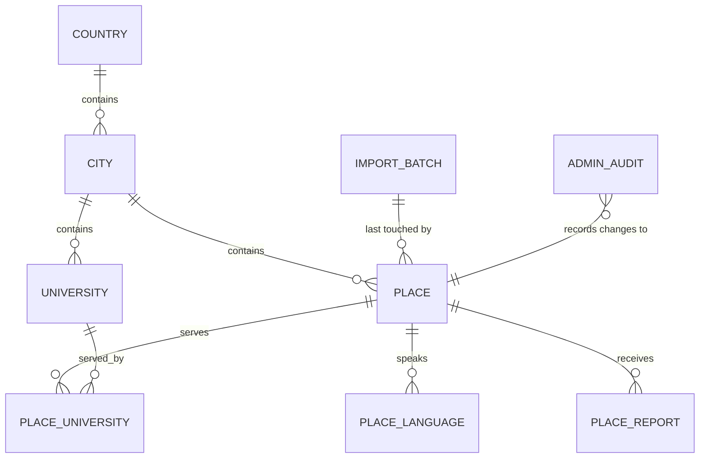

# Data model

> Status: pre-implementation · Last reviewed 2026-11-14 · Related:
> [ARCHITECTURE.md](ARCHITECTURE.md) · [API.md](API.md) · [CURATION.md](CURATION.md) ·
> [LOW_TECH_PILOT.md](LOW_TECH_PILOT.md)

## 1. Principles

1. **The database stores facts a curator confirmed**, not every fact a church publishes. A missing
   service time is better than a wrong one.
2. **Public visibility is a server rule.** Drafts, hidden places and expired places never leave the
   API, even if someone guesses a URL.
3. **No student data.** There is no user table, no profile table and no IP column.
4. **Soft delete for places.** A closed church may need to come back, and a report may need history.
5. **Migrations are immutable.** Flyway owns the schema; Hibernate only validates it.
6. **Singular table names.** `place`, not `places`, to match the naming rules in
   [CODE_STYLES.md](CODE_STYLES.md).

PostgreSQL 16+. Enumerations are stored as `varchar` with a `CHECK` constraint and mapped to Java
enums with `@Enumerated(EnumType.STRING)`. PostgreSQL enum types are avoided because adding a value
requires a migration that cannot run inside some transaction contexts and is awkward to roll back.

### 1.1 What is deliberately not modelled

This database serves the **map only**. It is not the system of record for the low-tech pilot.

| Not in this schema                                                | Where it lives instead                                 |
|-------------------------------------------------------------------|--------------------------------------------------------|
| Students, names, emails, destinations, departure dates            | `Students` tab of the restricted pilot spreadsheet     |
| Parents, guardians and consent records                            | The pilot's consent record, held by the sending church |
| Connectors, their contact routes and safeguarding references      | `Connectors` tab of the restricted pilot spreadsheet   |
| Matches, introductions and follow-up outcomes                     | `Students` tab follow-up columns; email threads        |
| Matchmaker accounts, roles or task queues                         | No account system exists                               |
| Any IP address, session history or browsing profile for a student | Nowhere; the map stores neither                        |

The only person-linked data this schema holds is an **optional email on a private report**, which is
used only to reply and is deleted on the schedule in §13.

Do not add a `student`, `connector`, `match` or `introduction` table to this schema "for later". If a
future tool needs those records, it is a separate application with its own consent basis,
safeguarding controls and threat model, as stated in
[ARCHITECTURE.md](ARCHITECTURE.md) §1.1. The pilot's three tabs are described in
[LOW_TECH_PILOT.md](LOW_TECH_PILOT.md) §6.

The `Places` tab is the one export path between the two: it becomes a CSV for admin import (§11) or
is entered by a curator. It contains no student or connector data.

## 2. Entity relationship diagram



## 3. Reference data

### 3.1 `country`

| Column | Type          | Null | Default | Notes                                      |
|--------|---------------|------|---------|--------------------------------------------|
| `code` | `char(2)`     | no   | —       | ISO 3166-1 alpha-2, primary key            |
| `name` | `varchar(80)` | no   | —       | Display name, for example "United Kingdom" |
| `slug` | `varchar(40)` | no   | —       | URL segment, for example `uk`; unique      |

### 3.2 `city`

| Column         | Type                                  | Null | Default | Notes                                       |
|----------------|---------------------------------------|------|---------|---------------------------------------------|
| `id`           | `bigint generated always as identity` | no   | —       | Primary key                                 |
| `country_code` | `char(2)`                             | no   | —       | FK → `country.code`                         |
| `name`         | `varchar(120)`                        | no   | —       | "London"                                    |
| `slug`         | `varchar(80)`                         | no   | —       | URL segment, unique within country          |
| `summary`      | `varchar(200)`                        | yes  | null    | One sentence for the landing card           |
| `latitude`     | `numeric(9,6)`                        | no   | —       | Map centre                                  |
| `longitude`    | `numeric(9,6)`                        | no   | —       | Map centre                                  |
| `published`    | `boolean`                             | no   | `false` | Whether the city page is publicly reachable |
| `created_at`   | `timestamptz`                         | no   | `now()` |                                             |
| `updated_at`   | `timestamptz`                         | no   | `now()` |                                             |

Constraints and indexes:

- `unique (country_code, slug)`
- `check (latitude between -90 and 90)`
- `check (longitude between -180 and 180)`
- `index on (published)`

A city is publicly listed only when `published = true` **and** it has at least one publicly visible
place. The second condition is a service rule, not a database constraint.

### 3.3 `university`

| Column        | Type                                  | Null | Default | Notes                                  |
|---------------|---------------------------------------|------|---------|----------------------------------------|
| `id`          | `bigint generated always as identity` | no   | —       | Primary key                            |
| `city_id`     | `bigint`                              | no   | —       | FK → `city.id`                         |
| `name`        | `varchar(200)`                        | no   | —       | Full name                              |
| `short_name`  | `varchar(60)`                         | yes  | null    | "Imperial", "U of T"                   |
| `slug`        | `varchar(100)`                        | no   | —       | URL/filter segment, unique within city |
| `latitude`    | `numeric(9,6)`                        | yes  | null    | Optional campus point                  |
| `longitude`   | `numeric(9,6)`                        | yes  | null    | Optional campus point                  |
| `website_url` | `varchar(500)`                        | yes  | null    |                                        |
| `published`   | `boolean`                             | no   | `true`  | Hide a university without deleting it  |
| `created_at`  | `timestamptz`                         | no   | `now()` |                                        |
| `updated_at`  | `timestamptz`                         | no   | `now()` |                                        |

Constraints and indexes:

- `unique (city_id, slug)`
- `index on (city_id, published)`

Universities are reference data in v1. Adding one is a migration or a seeded reference-data change,
not an admin screen. This is acceptable while the pilot is small; see
[OPEN_QUESTIONS.md](OPEN_QUESTIONS.md).

## 4. `place`

| Column                       | Type                                  | Null | Default   | Notes                                             |
|------------------------------|---------------------------------------|------|-----------|---------------------------------------------------|
| `id`                         | `bigint generated always as identity` | no   | —         | Primary key                                       |
| `slug`                       | `varchar(140)`                        | no   | —         | Globally unique public URL segment                |
| `name`                       | `varchar(160)`                        | no   | —         | Public name                                       |
| `type`                       | `varchar(24)`                         | no   | —         | `CHURCH`, `CAMPUS_MINISTRY`, `STUDENT_SOCIETY`    |
| `city_id`                    | `bigint`                              | no   | —         | FK → `city.id`                                    |
| `address`                    | `varchar(300)`                        | no   | —         | Display address, not parsed                       |
| `latitude`                   | `numeric(9,6)`                        | no   | —         |                                                   |
| `longitude`                  | `numeric(9,6)`                        | no   | —         |                                                   |
| `website_url`                | `varchar(500)`                        | yes  | null      | Public website; no personal contact data          |
| `description`                | `varchar(240)`                        | no   | —         | One factual curator sentence                      |
| `tradition`                  | `varchar(32)`                         | no   | —         | See §5                                            |
| `size_category`              | `varchar(16)`                         | no   | `UNKNOWN` | `SMALL`, `MEDIUM`, `LARGE`, `UNKNOWN`             |
| `international_congregation` | `boolean`                             | no   | `false`   | Curator-confirmed                                 |
| `tck_friendly`               | `boolean`                             | no   | `false`   | Curator-confirmed, two-person rule                |
| `hk_student_presence`        | `varchar(16)`                         | no   | `UNKNOWN` | `NONE`, `A_FEW`, `SEVERAL`, `LARGE`, `UNKNOWN`    |
| `car_free_access`            | `boolean`                             | no   | `false`   | Confirmed by curator                              |
| `nearest_transit`            | `varchar(160)`                        | yes  | null      | "South Kensington (Piccadilly, District, Circle)" |
| `walk_minutes_from_transit`  | `smallint`                            | yes  | null      | 0–120                                             |
| `transit_note`               | `varchar(800)`                        | yes  | null      | Written from a student's perspective              |
| `accessibility_note`         | `varchar(500)`                        | yes  | null      | Only confirmed facts                              |
| `service_note`               | `varchar(500)`                        | yes  | null      | Free text; no structured schedule                 |
| `verification_status`        | `varchar(24)`                         | no   | `DRAFT`   | `DRAFT`, `VERIFIED`, `NEEDS_REVERIFY`, `HIDDEN`   |
| `last_verified_at`           | `timestamptz`                         | yes  | null      | Required when verified                            |
| `verified_by`                | `varchar(120)`                        | yes  | null      | Public display name, for example "Rachel C."      |
| `source_url`                 | `varchar(500)`                        | yes  | null      | Evidence used for verification                    |
| `curator_note`               | `varchar(2000)`                       | yes  | null      | Internal only, never serialised publicly          |
| `last_import_batch_id`       | `bigint`                              | yes  | null      | FK → `import_batch.id`                            |
| `version`                    | `integer`                             | no   | `0`       | JPA optimistic lock                               |
| `created_at`                 | `timestamptz`                         | no   | `now()`   |                                                   |
| `updated_at`                 | `timestamptz`                         | no   | `now()`   |                                                   |
| `deleted_at`                 | `timestamptz`                         | yes  | null      | Soft delete                                       |

Constraints:

```sql
check (slug ~ '^[a-z0-9]+(-[a-z0-9]+)*$')
check (description ~ '\S')
check (char_length(description) between 30 and 240)
check (latitude between -90 and 90)
check (longitude between -180 and 180)
check (walk_minutes_from_transit is null or walk_minutes_from_transit between 0 and 120)
check (
	verification_status <> 'VERIFIED'
	or (last_verified_at is not null and verified_by is not null and source_url is not null)
)
```

Every enum column (`type`, `tradition`, `size_category`, `hk_student_presence`,
`verification_status`) also has a `check` constraint listing the codes in §5. The database rejects
an unknown code even if the application validation is bypassed.

Indexes:

- `unique (slug)` — also the lookup for `/places/{slug}`
- `index on (city_id, verification_status, deleted_at)`
- `index on (last_verified_at)` — stale queries and admin sorting
- `index on (type)`

**Why no `published` boolean?** `verification_status` already expresses draft, verified and hidden.
A separate boolean would create an ambiguous state ("published but hidden") and a second rule for
every query.

**Why no `phone` or leader email?** Personal contact data creates consent and retention obligations
without solving the student's problem. Link to the organisation's public website instead.

**Why no structured service times?** They change weekly and become wrong faster than a curator can
verify them. `service_note` records what was true at verification, and the UI sends the student to
the website for the current schedule.

**Why `curator_note` is a column, not a separate table:** v1 has one short internal note per place.
If notes become a threaded log, move them to `place_note` with authorship and timestamps.

## 5. Enumerations

### 5.1 `place.type`

| Code              | Public label    | Meaning                                                                       |
|-------------------|-----------------|-------------------------------------------------------------------------------|
| `CHURCH`          | Church          | A congregation with regular public worship                                    |
| `CAMPUS_MINISTRY` | Campus ministry | A ministry working on or around a campus, usually with a sending organisation |
| `STUDENT_SOCIETY` | Student society | A student-run Christian society or fellowship                                 |

### 5.2 `place.tradition`

| Code                 | Public label       |
|----------------------|--------------------|
| `ANGLICAN`           | Anglican           |
| `BAPTIST`            | Baptist            |
| `CATHOLIC`           | Catholic           |
| `CHARISMATIC`        | Charismatic        |
| `EVANGELICAL`        | Evangelical        |
| `LUTHERAN`           | Lutheran           |
| `METHODIST`          | Methodist          |
| `NON_DENOMINATIONAL` | Non-denominational |
| `ORTHODOX`           | Orthodox           |
| `PENTECOSTAL`        | Pentecostal        |
| `PRESBYTERIAN`       | Presbyterian       |
| `OTHER`              | Other              |

A tradition is the organisation's **self-description**, condensed to a broad family. Do not label a
church "evangelical" if it rejects the term. If a church spans two families, choose the one it uses
first and record the nuance in the description.

### 5.3 `place.size_category`

| Code      | Definition                                     |
|-----------|------------------------------------------------|
| `SMALL`   | Fewer than 50 regular weekly attenders         |
| `MEDIUM`  | 50–150 regular weekly attenders                |
| `LARGE`   | More than 150 regular weekly attenders         |
| `UNKNOWN` | A leader declined or no reliable figure exists |

### 5.4 `place.hk_student_presence`

| Code      | Definition                             |
|-----------|----------------------------------------|
| `NONE`    | Curator knows of no Hong Kong students |
| `A_FEW`   | One or two known students              |
| `SEVERAL` | Roughly three to ten known students    |
| `LARGE`   | More than ten known students           |
| `UNKNOWN` | Not established                        |

This is a curator estimate from conversation, never a scraped count. The public UI shows a phrase,
not a number.

### 5.5 `place.verification_status`

| Code             | Public              | Meaning                                                                                |
|------------------|---------------------|----------------------------------------------------------------------------------------|
| `DRAFT`          | No                  | Created or imported but not yet verified                                               |
| `VERIFIED`       | Yes, if not expired | Curator confirmed the record against a source and, where possible, a human             |
| `NEEDS_REVERIFY` | No                  | Something is doubtful or a report is unresolved; hide until checked                    |
| `HIDDEN`         | No                  | Removed at the request of the organisation, because it closed, or for a safety concern |

### 5.6 `place_report.report_type`

| Code             | Meaning                                          | Target response                          |
|------------------|--------------------------------------------------|------------------------------------------|
| `OUTDATED`       | Service time, address or description has changed | 7 days                                   |
| `WRONG_INFO`     | A fact is wrong                                  | 7 days                                   |
| `CLOSED`         | The church or ministry has closed or moved       | 72 hours                                 |
| `NEW_SUGGESTION` | Suggest a place not listed                       | 14 days                                  |
| `SAFETY_CONCERN` | A safeguarding or safety concern                 | 24 hours, hide first, investigate second |
| `OTHER`          | Anything else                                    | 14 days                                  |

### 5.7 `place_report.status`

`OPEN` → `IN_REVIEW` → `RESOLVED` or `DISMISSED`.

## 6. Relationship tables

### 6.1 `place_language`

| Column          | Type          | Null | Notes                                       |
|-----------------|---------------|------|---------------------------------------------|
| `place_id`      | `bigint`      | no   | FK → `place.id`, cascade delete             |
| `language_code` | `varchar(16)` | no   | `ENGLISH`, `CANTONESE`, `MANDARIN`, `OTHER` |
| `is_primary`    | `boolean`     | no   | Exactly one primary per place               |

- Primary key: `(place_id, language_code)`
- Partial unique index: `unique (place_id) where is_primary`
- A bilingual church has two rows, one marked primary.

### 6.2 `place_university`

| Column          | Type       | Null | Notes                             |
|-----------------|------------|------|-----------------------------------|
| `place_id`      | `bigint`   | no   | FK → `place.id`, cascade delete   |
| `university_id` | `bigint`   | no   | FK → `university.id`              |
| `walk_minutes`  | `smallint` | yes  | Curator estimate; null if unknown |

- Primary key: `(place_id, university_id)`
- `index on (university_id)`
- The service validates that the university is in the same city as the place.

## 7. `place_report`

| Column            | Type                                  | Null | Default | Notes                                        |
|-------------------|---------------------------------------|------|---------|----------------------------------------------|
| `id`              | `bigint generated always as identity` | no   | —       | Primary key                                  |
| `place_id`        | `bigint`                              | no   | —       | FK → `place.id`                              |
| `report_type`     | `varchar(24)`                         | no   | —       | See §5.6                                     |
| `message`         | `varchar(1000)`                       | no   | —       | Plain text, 10–1000 characters               |
| `contact_email`   | `varchar(254)`                        | yes  | null    | Optional; never public                       |
| `status`          | `varchar(16)`                         | no   | `OPEN`  | `OPEN`, `IN_REVIEW`, `RESOLVED`, `DISMISSED` |
| `resolution_note` | `varchar(1000)`                       | yes  | null    | Internal                                     |
| `resolved_by`     | `varchar(120)`                        | yes  | null    | Admin actor                                  |
| `created_at`      | `timestamptz`                         | no   | `now()` |                                              |
| `updated_at`      | `timestamptz`                         | no   | `now()` |                                              |
| `resolved_at`     | `timestamptz`                         | yes  | null    |                                              |

Indexes:

- `index on (status, created_at desc)`
- `index on (place_id, created_at desc)`

Constraint: `check (char_length(message) between 10 and 1000)`.

There is deliberately no `ip_address` column. Rate limiting uses an in-memory hash that is never
persisted. See [ARCHITECTURE.md](ARCHITECTURE.md) §9–10.

## 8. `import_batch` and `admin_audit`

### 8.1 `import_batch`

| Column            | Type                                  | Null | Notes                                  |
|-------------------|---------------------------------------|------|----------------------------------------|
| `id`              | `bigint generated always as identity` | no   | Primary key                            |
| `filename`        | `varchar(255)`                        | no   | Original file name                     |
| `checksum_sha256` | `char(64)`                            | no   | Detect a repeated upload               |
| `dry_run`         | `boolean`                             | no   | True when the batch rolled back        |
| `status`          | `varchar(16)`                         | no   | `RUNNING`, `COMPLETED`, `FAILED`       |
| `row_count`       | `integer`                             | no   | Data rows, excluding header            |
| `inserted_count`  | `integer`                             | no   |                                        |
| `updated_count`   | `integer`                             | no   |                                        |
| `skipped_count`   | `integer`                             | no   |                                        |
| `failed_count`    | `integer`                             | no   |                                        |
| `error_summary`   | `jsonb`                               | yes  | Array of `{row, field, code, message}` |
| `actor`           | `varchar(120)`                        | no   | Admin username                         |
| `created_at`      | `timestamptz`                         | no   |                                        |
| `finished_at`     | `timestamptz`                         | yes  |                                        |

`index on (created_at desc)`.

### 8.2 `admin_audit`

| Column        | Type                                  | Null | Notes                                                                                              |
|---------------|---------------------------------------|------|----------------------------------------------------------------------------------------------------|
| `id`          | `bigint generated always as identity` | no   | Primary key                                                                                        |
| `actor`       | `varchar(120)`                        | no   | Session username                                                                                   |
| `action`      | `varchar(40)`                         | no   | `CREATE_PLACE`, `UPDATE_PLACE`, `VERIFY_PLACE`, `HIDE_PLACE`, `RESOLVE_REPORT`, `IMPORT_COMMIT`, … |
| `entity_type` | `varchar(40)`                         | no   | `PLACE`, `REPORT`, `IMPORT_BATCH`                                                                  |
| `entity_id`   | `bigint`                              | yes  | Null for non-entity actions                                                                        |
| `detail`      | `jsonb`                               | yes  | Changed field names and safe before/after values                                                   |
| `created_at`  | `timestamptz`                         | no   |                                                                                                    |

`index on (entity_type, entity_id, created_at desc)`.

The audit log must not store report messages, email addresses or full row snapshots. Store field
names and old/new values for curator-editable fields only.

## 9. Public visibility rule

The canonical predicate, implemented once in `VisibilityPolicy` and used by every public query:

```sql
select p.*
from place p
join city c on c.id = p.city_id
where p.verification_status = 'VERIFIED'
	and p.deleted_at is null
	and p.last_verified_at >= now() - interval '365 days'
	and c.published = true;
```

Staleness is derived, not stored:

| Age                | API `staleness` | UI                             |
|--------------------|-----------------|--------------------------------|
| 0–180 days         | `FRESH`         | Green "Verified" badge         |
| 181–365 days       | `AGING`         | Amber "May be outdated" banner |
| More than 365 days | `EXPIRED`       | Not returned publicly          |

```sql
case
	when p.last_verified_at >= now() - interval '180 days' then 'FRESH'
	when p.last_verified_at >= now() - interval '365 days' then 'AGING'
	else 'EXPIRED'
end as staleness
```

Thresholds come from configuration (`stillknown.visibility.aging-after-days`,
`hide-after-days`) so the SQL and the tests stay in sync. The literals above are the defaults.

## 10. Representative queries

### 10.1 City payload

```sql
select p.*
from place p
where p.city_id = :cityId
	and p.verification_status = 'VERIFIED'
	and p.deleted_at is null
	and p.last_verified_at >= now() - interval '365 days'
order by p.name;
```

Languages and university links are fetched with `@EntityGraph` or a second query keyed by place
id; avoid a join that multiplies rows and then de-duplicates in Java.

### 10.2 Filtered city query

For v1, filtering happens in the client. The server endpoint still supports the same filters for
deep links and future scale:

```sql
select distinct p.*
from place p
join place_language pl on pl.place_id = p.id
where p.city_id = :cityId
	and (:typeCount = 0 or p.type in (:types))
	and (:traditionCount = 0 or p.tradition in (:traditions))
	and (:languageCount = 0 or pl.language_code in (:languages))
	and (:carFree = false or p.car_free_access = true)
	and (:tckFriendly = false or p.tck_friendly = true)
	and (:international = false or p.international_congregation = true)
	and (:universityId is null or exists (
		select 1 from place_university pu
		where pu.place_id = p.id and pu.university_id = :universityId
	))
	and p.verification_status = 'VERIFIED'
	and p.deleted_at is null
	and p.last_verified_at >= now() - interval '365 days';
```

### 10.3 Admin dashboard counts

```sql
select
	count(*) filter (where verification_status = 'DRAFT') as drafts,
	count(*) filter (where verification_status = 'VERIFIED'
		and last_verified_at >= now() - interval '180 days') as fresh,
	count(*) filter (where verification_status = 'VERIFIED'
		and last_verified_at < now() - interval '180 days'
		and last_verified_at >= now() - interval '365 days') as aging,
	count(*) filter (where verification_status = 'VERIFIED'
		and last_verified_at < now() - interval '365 days') as expired
from place
where deleted_at is null;
```

## 11. CSV seed format

The importer is the supported way to add places in bulk. One row per place.

The only accepted import file is the **`Places`** export. A `Students` or `Connectors` export is
rejected by design: those columns are not part of this contract, and no endpoint accepts them. If a
pilot export is accidentally uploaded, the dry run must fail on unknown columns rather than store the
data.

### 11.1 Columns

| Column                       | Required    | Example                                                                         | Rules                                                                |
|------------------------------|-------------|---------------------------------------------------------------------------------|----------------------------------------------------------------------|
| `slug`                       | yes         | `st-marys-london`                                                               | Lowercase kebab; stable across imports; must not be a reserved route |
| `name`                       | yes         | `St Mary's Church`                                                              | 2–160 characters                                                     |
| `type`                       | yes         | `CHURCH`                                                                        | Enum                                                                 |
| `country_slug`               | yes         | `uk`                                                                            | Must exist                                                           |
| `city_slug`                  | yes         | `london`                                                                        | Must exist in that country                                           |
| `address`                    | yes         | `York Street, London W1H 7JX`                                                   | Display text                                                         |
| `latitude`                   | yes         | `51.518900`                                                                     | Decimal degrees                                                      |
| `longitude`                  | yes         | `-0.158400`                                                                     | Decimal degrees                                                      |
| `website_url`                | no          | `https://example.org`                                                           | HTTPS preferred; validated URL                                       |
| `description`                | yes         | `An Anglican church near Marble Arch with a large international student group.` | 30–240 characters, no superlatives                                   |
| `tradition`                  | yes         | `ANGLICAN`                                                                      | Enum                                                                 |
| `size_category`              | no          | `MEDIUM`                                                                        | Enum; defaults to `UNKNOWN`                                          |
| `primary_language`           | yes         | `ENGLISH`                                                                       | Enum                                                                 |
| `other_languages`            | no          | `CANTONESE\|MANDARIN`                                                           | Pipe-separated enums                                                 |
| `international_congregation` | no          | `true`                                                                          | `true`/`false`                                                       |
| `tck_friendly`               | no          | `true`                                                                          | `true`/`false`                                                       |
| `hk_student_presence`        | no          | `SEVERAL`                                                                       | Enum; defaults to `UNKNOWN`                                          |
| `car_free_access`            | no          | `true`                                                                          | `true`/`false`                                                       |
| `nearest_transit`            | no          | `Marble Arch (Central)`                                                         | 160 characters                                                       |
| `walk_minutes_from_transit`  | no          | `4`                                                                             | 0–120                                                                |
| `transit_note`               | no          | `Central line to Marble Arch, then a 4-minute walk...`                          | 800 characters                                                       |
| `accessibility_note`         | no          | `Step-free entrance from York Street.`                                          | Only confirmed facts                                                 |
| `service_note`               | no          | `Sundays 10:30 and 17:00 during term; check the website.`                       | 500 characters                                                       |
| `universities`               | no          | `imperial-college-london:20\|university-college-london:25`                      | `slug:walk_minutes` pairs                                            |
| `verification_status`        | no          | `VERIFIED`                                                                      | Defaults to `DRAFT`                                                  |
| `last_verified_at`           | conditional | `2026-09-12`                                                                    | Required when verified; `YYYY-MM-DD` or ISO-8601                     |
| `verified_by`                | conditional | `Rachel C.`                                                                     | Required when verified                                               |
| `source_url`                 | conditional | `https://example.org/students`                                                  | Required when verified                                               |
| `curator_note`               | no          | `Spoke to the student worker on 12 Sep.`                                        | Internal only                                                        |

### 11.2 Import rules

- Encoding: UTF-8; a BOM is tolerated.
- Header row is required and column order is irrelevant.
- Unknown columns produce a warning and are ignored.
- Unknown enum values are errors, not silent defaults.
- Duplicate `slug` values inside one file are an error.
- `last_verified_at` without a time is interpreted as **12:00 UTC** to avoid the previous day in
  negative-offset time zones.
- If `verification_status = VERIFIED`, all three evidence fields are required.
- `primary_language` must not also appear in `other_languages`.
- University slugs must exist and belong to the same city.
- A row with `verification_status = HIDDEN` is accepted but never public.
- Upsert key is `slug`. Existing fields not present in the CSV are left unchanged? **No:** the CSV
  is treated as the full record for that slug, so omitted optional fields are cleared. This makes
  the file the source of truth for its rows. Document the behaviour in the import UI.
- Rows absent from the CSV are never deleted.
- Commit mode runs in one transaction. Any error rolls the whole batch back.

### 11.3 Error codes

| Code   | Meaning                                       |
|--------|-----------------------------------------------|
| `E001` | Missing required field                        |
| `E002` | Invalid enum value                            |
| `E003` | Duplicate slug in the file                    |
| `E004` | Unknown country or city                       |
| `E005` | Coordinate out of range                       |
| `E006` | Verified row missing date, verifier or source |
| `E007` | Invalid URL                                   |
| `E008` | Invalid date                                  |
| `E009` | Unknown university or wrong city              |
| `E010` | Slug collides with a reserved route           |
| `E011` | Primary language also listed as secondary     |
| `E012` | Value too long                                |

## 12. Migrations and seed workflow

- Flyway migrations live in `backend/src/main/resources/db/migration/`.
- Naming: `V001__baseline.sql`, `V002__reference_country_city.sql`, …
- `spring.jpa.hibernate.ddl-auto=validate`; Hibernate never changes the schema.
- Applied migrations are immutable. Fix a mistake with a new migration.
- Reference data for pilot countries, cities and universities is seeded by migration so a local
  database is usable immediately.
- Place data is **not** seeded by migration. It is imported through the admin CSV flow, which is
  auditable and repeatable.
- A local profile may auto-import `data/seed/*.csv` on startup when
  `STILLKNOWN_SEED_ON_START=true`. It still goes through the same parser and validation.
- Before a destructive migration, take a backup and rehearse the restore. Flyway Community does not
  provide automatic rollback.

## 13. Retention

| Data                           | Retention                                                                                        |
|--------------------------------|--------------------------------------------------------------------------------------------------|
| Resolved or dismissed report   | Contact email deleted 90 days after resolution; report row kept for 24 months for trend analysis |
| Open report                    | Contact email deleted 180 days after submission if still unresolved                              |
| Admin audit                    | 24 months                                                                                        |
| Import batch and error summary | 12 months                                                                                        |
| Application logs               | 30 days, no request bodies, no email addresses                                                   |
| IP addresses                   | Never stored                                                                                     |

## 14. JSON mapping notes

- Database `snake_case` never appears in the API; DTOs expose `camelCase`.
- `numeric(9,6)` coordinates are serialised as JSON numbers, not strings.
- `timestamptz` is serialised as an ISO-8601 UTC instant with `Z`.
- Enums are serialised as their code (`SCREAMING_SNAKE_CASE`), never their display label.
- Display labels and tag definitions live in the frontend translation bundle, not in the database.
- `curator_note`, `source_url`, `last_import_batch_id` and `version` are admin-only fields.
- `place_report.contact_email` is admin-only and never returned by a public endpoint.
